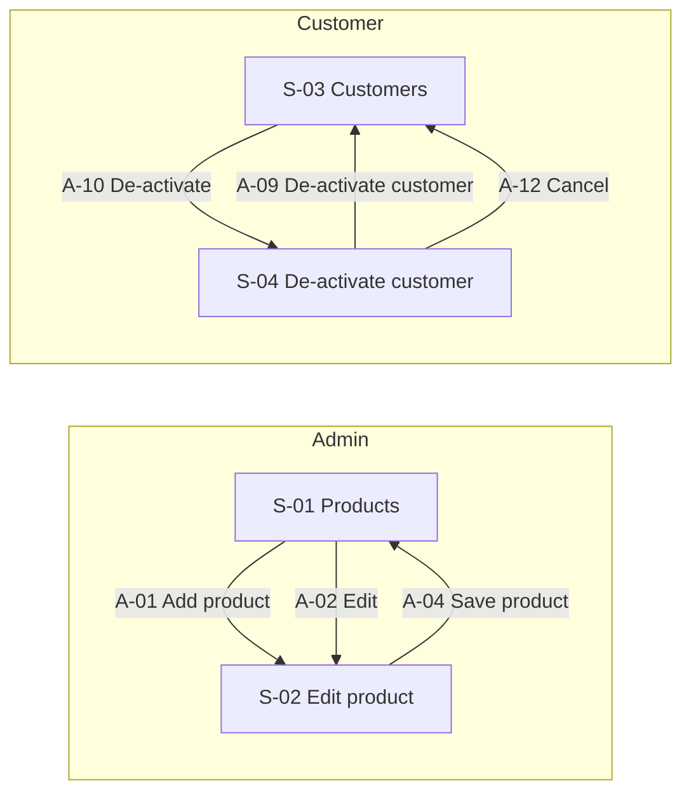
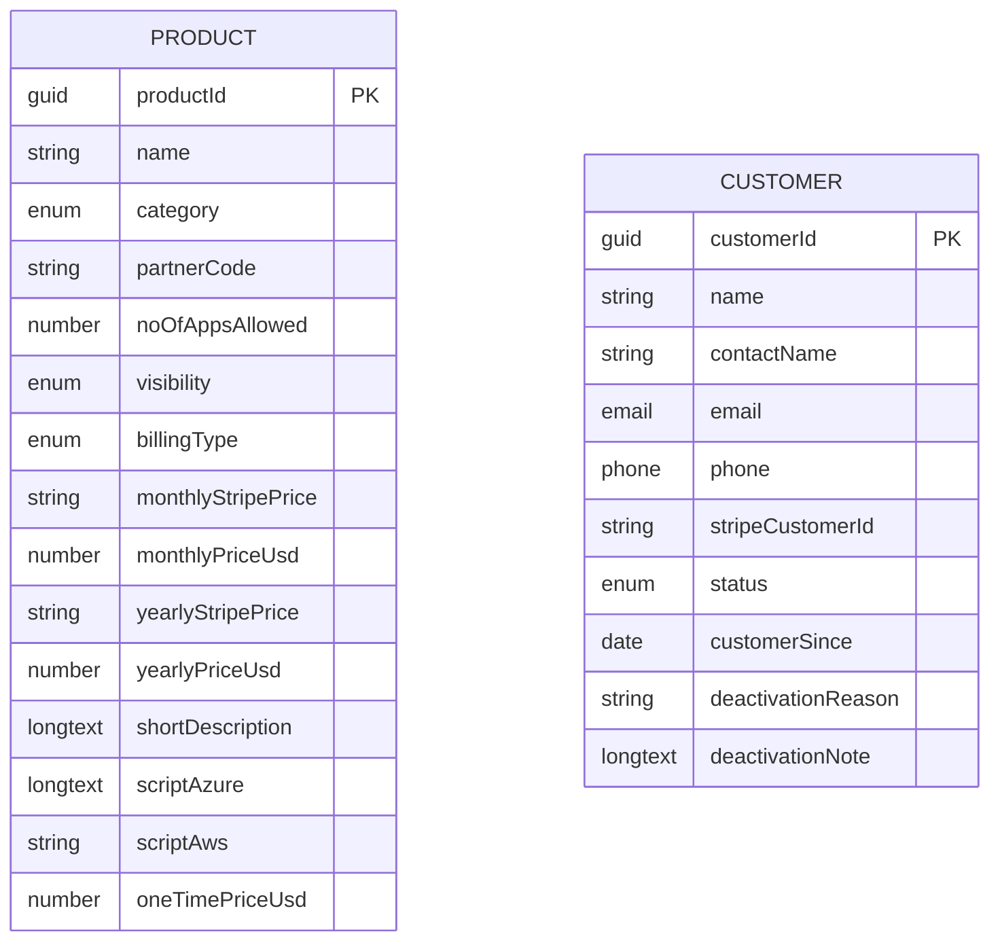
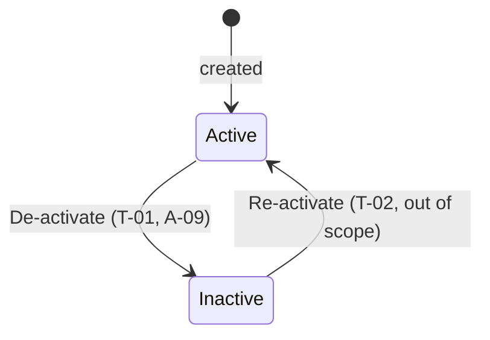

# Functional Specification — Nebula Products

## Document Control
| Field | Value |
|---|---|
| Version | 1.1 |
| Status | Approved |
| Date | 2026-10-06 |
| Author | Nebula |
| Approver | Paresh |
| Based on | 1.0 (Approved) |
| Inputs | IN-01 S11-product-catalog.png, IN-02 S12-product-form.png, IN-03 Customers split view, IN-04 De-activate RB? modal |
| Data source | nosql |
| Database | Cosmos DB |

### Change Log
| Version | Date | CR | Summary |
|---|---|---|---|
| 1.0 | 2026-10-06 | — | Initial draft from rationalized inputs + interview |
| 1.1 | 2026-10-06 | CR-001 | Add Customer entity (E-02), Customers split-view screen S-03 and De-activate customer dialog S-04; no v1.0 id changed |

## 1. Purpose & Scope
An admin catalog of plans and support packages (Product) and the customers who subscribe to them (Customer). v1.1 adds the Customers split view and the De-activate dialog.

**In scope:** module Admin — S-01, S-02, E-01; module Customer — S-03 Customers, S-04 De-activate customer, E-02 Customer; Product Management Agent (AG-01).

| ID | Item | Reason |
|---|---|---|
| OOS-01 | Sidebar modules iDIY'A, Subscription, Customer, Inquiry, Marketing Leads | Not in this request; shown as non-functional placeholders |
| OOS-02 | App shell controls: global search, notification icon, app-grid icon, user menu | Not in this request; non-functional placeholders |
| OOS-03 | Relationships from Product to Subscription or Customer | Q-001: Product stands alone in this build |
| OOS-04 | Live Stripe price lookup or sync | Option source unknown (AS-12) |
| OOS-05 | Subscription, Invoice and Payment method data: the Subscriptions, Invoices and Payment methods tabs and Recent invoices on S-03 | No fields shown; not modelled in v1.1 |

## 2. Users & Roles
No roles are defined (AS-17, AS-31).

## 3. Information Architecture
Module Admin → S-01 → S-02 (drawer). Module Customer → S-03 → S-04 (modal).

| ID | Screen | Archetype | Module | Entity | Nebula pattern | Forms (role) |
|---|---|---|---|---|---|---|
| S-01 | Products | collection | Admin | E-01 | List + Card Grid + Filter / Search | e588f7ab-bbbc-4540-93c9-eb7d2fc2b0e6 (main), 67aa70d6-44b1-433a-8430-d4332e394d0f (card) |
| S-02 | Edit product | entry | Admin | E-01 | Transaction + Panel | ccb72cf7-900b-44a7-afc0-01425d21d515 (main) |
| S-03 | Customers | collection | Customer | E-02 | List + Split View + Filter / Search + Tabs | 6421b203-cc6c-4acf-ae40-b3c83621641e (main), 31ed0d29-1164-44cb-8c5a-a5593bc5ef02 (search), 6caa76d1-6ae7-4a21-be3f-bcb5243f5891 (detail), fcaac76e-69ab-4852-bedc-a16561ef8823 (addEdit) |
| S-04 | De-activate customer | entry | Customer | E-02 | Transaction + Panel | 75f2b668-7fab-4ee6-af5a-47a6108db840 (main) |

### 3.1 Navigation Map (DG-S-01)

### 3.2 Wizard Flow Diagrams
None; no screen is a wizard.

### 3.3 Nebula Form & View Classification
| ID | Screen type | View pattern | Composition | Confidence | Rationale |
|---|---|---|---|---|---|
| S-01 | List | Card Grid | Filter / Search | user-confirmed | Eight repeated tiles with identical layout; no sortable columns, bulk actions or paging, so not Advanced Grid. The tab strip filters the result set, so it is Filter / Search, not Tabs. |
| S-02 | Transaction | — | Panel | user-confirmed | Create/edit form for one record shown as a right-side drawer; no steps and no section switching, so not a wizard or tabs. |
| S-03 | List | Split View | Filter / Search, Tabs | assumed | Customer list on the left and the selected customer's detail on the right on one page. |
| S-04 | Transaction | — | Panel | assumed | Single-record confirmation form shown as a modal; no steps or tabs. |

## 4. Data Model
### 4.0 Entity-Relationship Diagram (DG-S-10)

**E-01 Product** — A plan or support package that customers can subscribe to, with its category, visibility, billing type and pricing. Velocity: Slow. Classification: not decided. System of record: Cosmos DB - products collection (Nebula store, to be created).

| Field ID | Name | Type | Enum values | Origin | Notes |
|---|---|---|---|---|---|
| F-01.01 | Name | string | — | entry | required; max 150; key Name, property name |
| F-01.02 | Category | enum | PaaS, Managed | entry | required; key Category, property category |
| F-01.03 | Partner code | string | — | entry | optional; max 50; key PartnerCode, property partnerCode |
| F-01.04 | No. of apps allowed | number | — | entry | required; key NoOfAppsAllowed, property noOfAppsAllowed |
| F-01.05 | Visibility | enum | Public, Private, Draft | entry | required; key Visibility, property visibility |
| F-01.06 | Billing type | enum | One time, Recurring | entry | required; key BillingType, property billingType |
| F-01.07 | Monthly Stripe price | string | — | entry | optional; max 100; key MonthlyStripePrice, property monthlyStripePrice |
| F-01.08 | Monthly price (USD) | number | — | entry | optional; key MonthlyPriceUsd, property monthlyPriceUsd |
| F-01.09 | Yearly Stripe price | string | — | entry | optional; max 100; key YearlyStripePrice, property yearlyStripePrice |
| F-01.10 | Yearly price (USD) | number | — | entry | optional; key YearlyPriceUsd, property yearlyPriceUsd |
| F-01.11 | Short description | longtext | — | entry | optional; max 3000; key ShortDescription, property shortDescription |
| F-01.12 | Script (Azure) | longtext | — | entry | optional; key ScriptAzure, property scriptAzure |
| F-01.13 | Script (AWS) | string | — | entry | optional; max 4000; key ScriptAws, property scriptAws |
| F-01.14 | One-time price (USD) | number | — | entry | optional; assumed; key OneTimePriceUsd, property oneTimePriceUsd |
| F-01.15 | Product Id | guid | — | system | required; assumed; key ProductId, property productId |

**E-02 Customer** — A customer account that subscribes to products: contact details, Stripe customer reference, and an Active or Inactive status. Velocity: Customer. Classification: not decided. System of record: Cosmos DB - customers collection (Nebula store, to be created).

| Field ID | Name | Type | Enum values | Origin | Notes |
|---|---|---|---|---|---|
| F-02.01 | Customer Id | guid | — | system | required; assumed; key CustomerId, property customerId |
| F-02.02 | Name | string | — | entry | required; max 150; key Name, property name |
| F-02.03 | Contact name | string | — | entry | optional; max 150; key ContactName, property contactName |
| F-02.04 | Email | email | — | entry | optional; max 254; key Email, property email |
| F-02.05 | Phone | phone | — | entry | optional; max 30; key Phone, property phone |
| F-02.06 | Stripe customer ID | string | — | entry | optional; max 100; key StripeCustomerId, property stripeCustomerId |
| F-02.07 | Status | enum | Active, Inactive | system | required; key Status, property status |
| F-02.08 | Customer since | date | — | entry | optional; key CustomerSince, property customerSince |
| F-02.09 | Deactivation reason | string | — | entry | optional; max 100; assumed; key DeactivationReason, property deactivationReason |
| F-02.10 | Deactivation note | longtext | — | entry | optional; max 3000; assumed; key DeactivationNote, property deactivationNote |

Relationships: none (Q-001; CR-001).

### 4.1 Data Source & Database
| DataSource id | Source type | Database |
|---|---|---|
| 0d94b01a-685d-40b9-b641-b086224c0a9e | nosql | Cosmos DB |

### 4.2 Data Model Binding
| Entity | Model | Bound screens |
|---|---|---|
| E-01 Product | products | S-01, S-02 |
| E-02 Customer | customers | S-03, S-04 |

### 4.3 Roles and permissions
None defined.

### 4.4 State machines
**SM-01 Customer.Status** — initial Active; states Active, Inactive; not terminal (AS-26).

| ID | From | To | Trigger | Via | Tool |
|---|---|---|---|---|---|
| T-01 | Active | Inactive | Admin confirms De-activate in the dialog | A-09 | np_update_customer |
| T-02 | Inactive | Active | Re-activate (named in the dialog text; no control shown) | out of scope (AS-26) | — |

Illegal: Inactive → Inactive: Customer is already inactive.; Active → Active: Customer is already active.

### 4.5 Actions, endpoints and tools
| Action | Screen | Control | Operation | Endpoint | Tool | Transition |
|---|---|---|---|---|---|---|
| A-01 Add product | S-01 | addProduct | create | EP-001 (api) | np_create_product | — |
| A-02 Edit | S-01 | editProduct | get | EP-003 (api) | np_get_product | — |
| A-03 Filter products | S-01 | visibilityFilter | list | EP-004 (api) | np_list_product | — |
| A-04 Save product | S-02 | saveProduct | update | EP-002 (api) | np_update_product | — |
| A-07 Find customers | S-03 | customerSearch | list | EP-005 (api) | np_list_customer | — |
| A-08 View customer | S-03 | selectCustomer | get | EP-006 (api) | np_get_customer | — |
| A-09 De-activate customer | S-04 | confirmDeactivate | update | EP-007 (api) | np_update_customer | T-01 |

Client-side controls (no tool or endpoint): A-05 cancelProduct (dismiss) on S-02; A-06 closeProduct (dismiss) on S-02; A-10 deactivateCustomer (open_dialog) on S-03; A-11 applyPromo (placeholder) on S-03; A-12 cancelDeactivate (dismiss) on S-04; A-13 applyPromoDialog (placeholder) on S-04.

| Endpoint | Method | Path | MCP tool |
|---|---|---|---|
| EP-001 | post | /products | create_record |
| EP-002 | patch | /products/ProductId/{ProductId} | update_record |
| EP-003 | get | /products/ProductId/{ProductId} | read_records |
| EP-004 | get | /products | read_records |
| EP-005 | get | /customers | read_records |
| EP-006 | get | /customers/CustomerId/{CustomerId} | read_records |
| EP-007 | patch | /customers/CustomerId/{CustomerId} | update_record |

### 4.6 Workflows
None.

### 4.7 Agent
Product Management Agent (AG-01), model sonnet — Talks to an admin user; no scheduled or multi-document work (Q-019).

Intents: List products; Show one product's details; Create a product; Update a product; List customers; Show one customer's details; De-activate a customer. Exclusions: Deleting products; Anything outside Products and Customers (Subscription, Inquiry, Marketing Leads).

| Tool | Entity | MCP tool | Endpoint | Actions |
|---|---|---|---|---|
| np_create_product | E-01 | create_record | EP-001 | A-01 |
| np_get_product | E-01 | read_records | EP-003 | A-02 |
| np_list_product | E-01 | read_records | EP-004 | A-03 |
| np_update_product | E-01 | update_record | EP-002 | A-04 |
| np_list_customer | E-02 | read_records | EP-005 | A-07 |
| np_get_customer | E-02 | read_records | EP-006 | A-08 |
| np_update_customer | E-02 | update_record | EP-007 | A-09 |

Skills to author: product-management, customer-management. Integration: MCP-01 sql-mcp-server (env NP_DAB_MCP_URL).

### 4.8 Data store and CRUD access
Source type nosql, Cosmos DB, camelCase_plural, DataSource id `0d94b01a-685d-40b9-b641-b086224c0a9e`. CRUD server: Data API builder (NoSQL). Env: NP_DAB_BASE_URL, NP_AGENT_BASE_URL.

## 5. Functional Requirements
**FR-1.1** The system shall list products as cards showing name, category, a visibility badge, price with its billing unit, and an Edit button. *(Source: S-01, E-01, A-03)*

**FR-1.2** The system shall filter the product cards by category (All, PaaS, Managed, with counts), by a Visibility filter, and by a name search. *(Source: S-01, E-01, A-03)*

**FR-1.3** An admin shall add a product through the product drawer, opened by Add product. *(Source: S-01, S-02, E-01, A-01, A-04)*

**FR-1.4** An admin shall edit a product through the same drawer, opened by Edit on its card, and save or cancel the change. *(Source: S-01, S-02, E-01, A-02, A-04)*

**FR-1.5** The form shall require Name, Category, No. of apps allowed, Visibility and Billing type, and limit Short description to 3000 characters. *(Source: S-02, E-01, A-04)*

**FR-1.6** The form shall show the recurring pricing (Stripe) panel when Billing type is Recurring and the one-time price when it is One time. *(Source: S-02, E-01, A-04)*

**FR-1.7** The Product Management Agent shall list, show, create and update products through the CRUD tools. *(Source: S-01, S-02, E-01, A-01, A-02, A-03, A-04)*

**FR-2.1** The system shall list customers on the left of a split view with a name search and a 'Show active customers only' toggle. *(Source: S-03, E-02, A-07)*

**FR-2.2** The system shall show the selected customer on the right: name, status, 'Customer since' date, and a contact card with contact name, email, phone and Stripe customer ID. *(Source: S-03, E-02, A-08)*

**FR-2.3** An admin shall de-activate an active customer through the De-activate dialog by giving a reason and an optional internal note and confirming; the customer's status becomes Inactive. *(Source: S-03, S-04, E-02, A-09)*

**FR-2.4** The dialog shall be dismissed without change by Cancel. *(Source: S-04, E-02)*

**FR-2.5** The Product Management Agent shall list and show customers and de-activate an active customer through the CRUD tools. *(Source: S-03, S-04, E-02, A-07, A-08, A-09)*

## 6. Interface & Navigation Requirements
- S-02 opens as a right-side drawer over S-01.
- S-03 shows the customer list left and the selected customer right; selecting a list item loads it.
- De-activate on S-03 opens S-04 as a modal; Cancel and a confirmed De-activate return to S-03.
- Apply promo, the filter button, the tabs' content and the sidebar items other than Product and Customer are non-functional placeholders.

## 7. Assumptions
| # | Assumption | Confidence | Evidence | Risk if wrong |
|---|---|---|---|---|
| AS-01 | A new field OneTimePriceUsd (F-01.14) holds the price of One time products and is shown when Billing type = One time; the Stripe pricing panel is shown for Recurring only. | user-delegated | Q-005, Q-006; IN-01 cards show $99/$199/$299 one-time | Wrong field or wrong visibility rule on the form |
| AS-02 | Visibility (Public, Private, Draft) is a label; Product has no state machine. | user-delegated | Q-012 | A lifecycle with transitions and guards would be missing |
| AS-03 | Velocity layer is Slow. | user-delegated | Q-010 | Caching and sync choices would change |
| AS-04 | Tool prefix is np; operations are create, get, list and update through the API endpoints; there is no delete. | user-delegated | Q-016 | Missing delete or different tool names |
| AS-05 | Add product opens the same drawer with no defaults. The Visibility filter is single-select (All, Public, Private, Draft); search matches Name; category counts are totals and do not react to search or the filter. | user-delegated | Q-018 | Different filter or count behaviour |
| AS-06 | The agent converses with an admin to list, show, create and update products; model sonnet; one skill product-management. | user-delegated | Q-019 | Agent scope or model would change |
| AS-07 | Collection name 'products' and camelCase property names for the nosql store. | user-delegated | Q-022 | Property or collection names would change |
| AS-08 | Maximum lengths not visible in the inputs are set to defaults: Name 150, Partner code 50, Stripe price fields 100, Script (AWS) 4000. ProductId is a system-set guid. | assumed | No lengths shown in IN-02; Q-002 (ProductId only) | Longer values rejected or truncated |
| AS-09 | Add and Edit share one screen, S-02, titled 'Edit product' as in IN-02. | assumed | IN-02 shows only the edit state | A separate Add screen may be needed |
| AS-10 | The panel title text is stored in sentence case; the preview styles it uppercase as in IN-02. | assumed | IN-02 shows 'RECURRING PRICING (STRIPE)' | Title casing |
| AS-11 | Data classification for Product is not decided. | open | Q-011 (GAP-02) | — |
| AS-12 | The source of the Monthly and Yearly Stripe price options and any rule tying them to the USD prices are unknown; the dropdowns are non-functional. | open | GAP-12 | — |
| AS-13 | Whether the drawer has fields below Script (AWS) is unknown; none are added. | open | GAP-13 | — |
| AS-14 | The purpose and maximum length of the Script (Azure) and Script (AWS) fields are unknown; Script (Azure) is multi-line and Script (AWS) single-line as seen. | open | GAP-14 | — |
| AS-15 | The second chip ('NCAMEO') on every card is shown as static text and is not bound to any field. | open | GAP-07 | — |
| AS-16 | The card banner colour is presentational and not a stored field. | open | GAP-08 | — |
| AS-17 | Who may view, add and edit products is unknown; no roles are defined and the CRUD access role is undecided. | open | GAP-15 | — |
| AS-18 | No delete or archive control exists in the inputs; whether Draft is the way to retire a product is unconfirmed. | open | GAP-16 | — |
| AS-19 | Data API builder (NoSQL) support for Cosmos DB, for both REST and MCP, must be verified before BUILD. | open | data_store caveat | — |
| AS-20 | Reachability of the Nebula workbench and agent editor was not verified at G0 and must be verified before BUILD. | open | G0 deferred check | — |
| AS-21 | Customer is a new entity E-02 with ten fields (F-02.01 to F-02.10); Product and Customer have no relationship in this build. | user-confirmed | CR-001 G2 confirmed | — |
| AS-22 | Maximum lengths not visible in IN-03 / IN-04 are defaults: Name 150, Contact name 150, Email 254, Phone 30, Stripe customer ID 100, Deactivation reason 100, Deactivation note 3000. CustomerId is a system-set guid. | assumed | No lengths shown | Longer values rejected or truncated |
| AS-23 | New customers start as Active; Status is changed only by the De-activate action. | assumed | IN-03 shows Active; IN-04 shows De-activate | Status could also be editable on a form |
| AS-24 | Search matches Name; the 'Show active customers only' toggle filters Status = Active. | assumed | IN-03 controls | Different search fields or filter meaning |
| AS-25 | Deactivation reason is stored as text; the dropdown options are not shown, so the dropdown is empty and non-functional. | open | IN-04 Reason dropdown (GAP-17) | — |
| AS-26 | Re-activate (Inactive to Active) is named in the dialog text but no control is shown; T-02 has no tool or screen. | open | IN-04 text (GAP-18) | — |
| AS-27 | What Apply promo (S-03) and the promo code Apply (S-04) do, and which promo codes exist, is unknown; both are non-functional. | open | IN-03, IN-04 (GAP-19) | — |
| AS-28 | The filter button beside the search box on S-03 has unknown behaviour; non-functional. | open | IN-03 (GAP-20) | — |
| AS-29 | Sidebar counts and menu items other than Product and Customer remain non-functional placeholders. | open | IN-03 (GAP-21) | — |
| AS-30 | No add or edit control for customers is shown; the Customers Add/Edit form is generated as required by Split View but nothing opens it. | open | IN-03 (GAP-22) | — |
| AS-31 | Data classification for Customer is not decided; who may view or de-activate customers is unknown (no roles). | open | GAP-02 / GAP-15 extended | — |

## 8. Open Items
| Item | Owner |
|---|---|
| AS-11 Data classification for Product is not decided. | User |
| AS-12 The source of the Monthly and Yearly Stripe price options and any rule tying them to the USD prices are unknown; the dropdowns are non-functional. | User |
| AS-13 Whether the drawer has fields below Script (AWS) is unknown; none are added. | User |
| AS-14 The purpose and maximum length of the Script (Azure) and Script (AWS) fields are unknown; Script (Azure) is multi-line and Script (AWS) single-line as seen. | User |
| AS-15 The second chip ('NCAMEO') on every card is shown as static text and is not bound to any field. | User |
| AS-16 The card banner colour is presentational and not a stored field. | User |
| AS-17 Who may view, add and edit products is unknown; no roles are defined and the CRUD access role is undecided. | User |
| AS-18 No delete or archive control exists in the inputs; whether Draft is the way to retire a product is unconfirmed. | User |
| AS-19 Data API builder (NoSQL) support for Cosmos DB, for both REST and MCP, must be verified before BUILD. | User |
| AS-20 Reachability of the Nebula workbench and agent editor was not verified at G0 and must be verified before BUILD. | User |
| AS-25 Deactivation reason is stored as text; the dropdown options are not shown, so the dropdown is empty and non-functional. | User |
| AS-26 Re-activate (Inactive to Active) is named in the dialog text but no control is shown; T-02 has no tool or screen. | User |
| AS-27 What Apply promo (S-03) and the promo code Apply (S-04) do, and which promo codes exist, is unknown; both are non-functional. | User |
| AS-28 The filter button beside the search box on S-03 has unknown behaviour; non-functional. | User |
| AS-29 Sidebar counts and menu items other than Product and Customer remain non-functional placeholders. | User |
| AS-30 No add or edit control for customers is shown; the Customers Add/Edit form is generated as required by Split View but nothing opens it. | User |
| AS-31 Data classification for Customer is not decided; who may view or de-activate customers is unknown (no roles). | User |

## 9. Glossary
| Term | Definition |
|---|---|
| Product | A plan or support package customers can subscribe to (page subtitle in IN-01). |
| Category | PaaS or Managed; also the All / PaaS / Managed tabs on the Products screen. |
| Visibility | Public, Private or Draft; Public and Private appear as a badge on each card. |
| Billing type | One time or Recurring; decides which pricing fields apply. |
| Stripe price | A Stripe price id (shown as price_...) chosen for the monthly or yearly price of a recurring product. |
| Customer | An account that subscribes to products; listed in the Customers split view. |
| De-activate | Sets a customer's status to Inactive, with a reason and optional internal note. |
