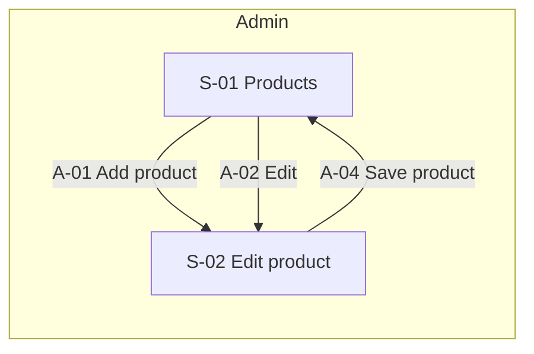
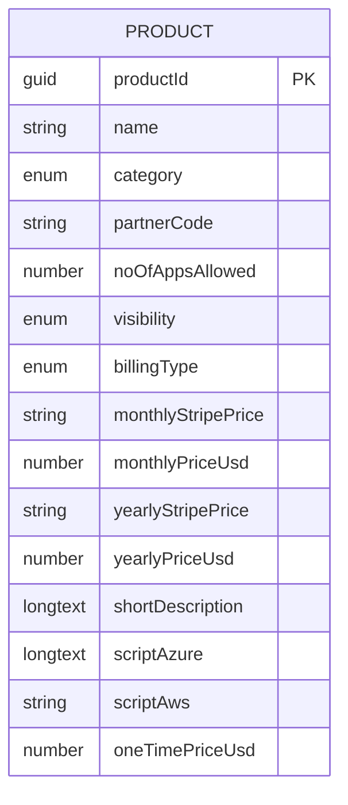

# Functional Specification — Nebula Products

## Document Control
| Field | Value |
|---|---|
| Version | 1.0 |
| Status | Draft |
| Date | 2026-10-06 |
| Author | Nebula |
| Approver | — |
| Inputs | IN-01 S11-product-catalog.png, IN-02 S12-product-form.png |
| Data source | nosql |
| Database | Cosmos DB |

### Change Log
| Version | Date | Author | Summary |
|---|---|---|---|
| 1.0 | 2026-10-06 | Nebula | Initial draft from rationalized inputs + interview |

## 1. Purpose & Scope
An admin catalog of plans and support packages that customers can subscribe to. This build covers one entity, Product: a card-based Products screen with filtering and search, and one drawer form to add or edit a product. Everything else visible in the screenshots is out of scope.

**In scope:** module Admin — S-01 Products, S-02 Edit product, entity E-01 Product, Product Management Agent (AG-01).

| ID | Item | Reason | Source |
|---|---|---|---|
| OOS-01 | Sidebar modules iDIY'A, Subscription, Customer, Inquiry, Marketing Leads | Not in this request; shown as non-functional placeholders | IN-01, Q-001 |
| OOS-02 | App shell controls: global search, notification icon, app-grid icon, user menu | Not in this request; non-functional placeholders | IN-01, Q-001 |
| OOS-03 | Relationships from Product to Subscription or Customer | Q-001: Product stands alone in this build | IN-01, Q-001 |
| OOS-04 | Live Stripe price lookup or sync | Option source unknown (AS-12) | IN-01, Q-001 |

## 2. Users & Roles
No roles are defined in this build; the screenshots show a single user ('NCAMEO Admin'). See AS-17 and §8.

| ID | Role | Description | Access summary | Source |
|---|---|---|---|---|
| — | — | — | — | AS-17 |

## 3. Information Architecture
Module Admin → S-01 Products → S-02 Edit product (drawer).

| ID | Form id | Screen | Archetype | Module | Primary entity | Model | Key actions | Nebula pattern |
|---|---|---|---|---|---|---|---|---|
| S-01 | e588f7ab-bbbc-4540-93c9-eb7d2fc2b0e6 | Products | collection | Admin | E-01 | products | A-01, A-02, A-03 | List + Card Grid + Filter / Search |
| S-02 | ccb72cf7-900b-44a7-afc0-01425d21d515 | Edit product | entry | Admin | E-01 | products | A-04 | Transaction + Panel |

Supporting form: Products — Card (`67aa70d6-44b1-433a-8430-d4332e394d0f`, role card) — the custom card design used by S-01.

### 3.1 Navigation Map (DG-S-01)

### 3.2 Wizard Flow Diagrams (DG-S-02+)
None; no screen is a wizard.

### 3.3 Nebula Form & View Classification
| ID | Screen | Screen type | View pattern | Composition | Confidence | Rationale |
|---|---|---|---|---|---|---|
| S-01 | Products | List | Card Grid | Filter / Search | user-confirmed | Eight repeated tiles with identical layout; no sortable columns, bulk actions or paging, so not Advanced Grid. The tab strip filters the result set, so it is Filter / Search, not Tabs. |
| S-02 | Edit product | Transaction | — | Panel | user-confirmed | Create/edit form for one record shown as a right-side drawer; no steps and no section switching, so not a wizard or tabs. |

## 4. Data Model
### 4.0 Entity-Relationship Diagram (DG-S-10)

**E-01 Product** — A plan or support package that customers can subscribe to, with its category, visibility, billing type and pricing. Velocity: Slow. Classification: not decided (AS-11). System of record: Cosmos DB - products collection (Nebula store, to be created).

| Field ID | Name | Type | Enum values | Origin | Notes |
|---|---|---|---|---|---|
| F-01.01 | Name | string | — | entry | required; max 150; key Name, property name |
| F-01.02 | Category | enum | PaaS, Managed | entry | required; key Category, property category |
| F-01.03 | Partner code | string | — | entry | optional; max 50; key PartnerCode, property partnerCode |
| F-01.04 | No. of apps allowed | number | — | entry | required; key NoOfAppsAllowed, property noOfAppsAllowed |
| F-01.05 | Visibility | enum | Public, Private, Draft | entry | required; key Visibility, property visibility |
| F-01.06 | Billing type | enum | One time, Recurring | entry | required; key BillingType, property billingType |
| F-01.07 | Monthly Stripe price | string | — | entry | optional; max 100; key MonthlyStripePrice, property monthlyStripePrice |
| F-01.08 | Monthly price (USD) | number | — | entry | optional; key MonthlyPriceUsd, property monthlyPriceUsd |
| F-01.09 | Yearly Stripe price | string | — | entry | optional; max 100; key YearlyStripePrice, property yearlyStripePrice |
| F-01.10 | Yearly price (USD) | number | — | entry | optional; key YearlyPriceUsd, property yearlyPriceUsd |
| F-01.11 | Short description | longtext | — | entry | optional; max 3000; key ShortDescription, property shortDescription |
| F-01.12 | Script (Azure) | longtext | — | entry | optional; key ScriptAzure, property scriptAzure |
| F-01.13 | Script (AWS) | string | — | entry | optional; max 4000; key ScriptAws, property scriptAws |
| F-01.14 | One-time price (USD) | number | — | entry | optional; assumed; key OneTimePriceUsd, property oneTimePriceUsd |
| F-01.15 | Product Id | guid | — | system | required; assumed; key ProductId, property productId |

Relationships: none. Product stands alone in this build (Q-001).

### 4.1 Data Source & Database
| DataSource id | Source type | Database | Confidence | Source |
|---|---|---|---|---|
| 0d94b01a-685d-40b9-b641-b086224c0a9e | nosql | Cosmos DB | user-confirmed | Q-020, Q-021 |

The DataSource id is a generated v4 GUID, immutable. Caveat: DAB NoSQL support to be verified for both REST and MCP before BUILD.

### 4.2 Data Model Binding (Entity → Model)
| Entity ID | Entity | Model name | Bound screens | Confidence | Notes |
|---|---|---|---|---|---|
| E-01 | Product | products | S-01, S-02 | user-delegated | camelCase plural collection; Q-022 |

### 4.3 Roles and permissions
None defined (AS-17).

### 4.4 State machines
None. Visibility is a label, not a lifecycle (AS-02).

### 4.5 Actions, endpoints and tools
| Action | Screen | Control | Operation | Endpoint (type) | Tool | Transition | Triggers |
|---|---|---|---|---|---|---|---|
| A-01 Add product | S-01 | addProduct | create | EP-001 (api) | np_create_product | — | — |
| A-02 Edit | S-01 | editProduct | get | EP-003 (api) | np_get_product | — | — |
| A-03 Filter products | S-01 | visibilityFilter | list | EP-004 (api) | np_list_product | — | — |
| A-04 Save product | S-02 | saveProduct | update | EP-002 (api) | np_update_product | — | — |

Client-side controls on S-02 (no tool or endpoint): A-05 Cancel and A-06 Close both return to S-01.

| Endpoint | Method | Path | Served by | MCP tool |
|---|---|---|---|---|
| EP-001 | post | /products | sql-mcp-server REST | create_record |
| EP-002 | patch | /products/ProductId/{ProductId} | sql-mcp-server REST | update_record |
| EP-003 | get | /products/ProductId/{ProductId} | sql-mcp-server REST | read_records |
| EP-004 | get | /products | sql-mcp-server REST | read_records |

### 4.6 Workflows
None.

### 4.7 Agent
Product Management Agent (AG-01), model sonnet — Talks to an admin user; no scheduled or multi-document work (Q-019).

Intents: List products; Show one product's details; Create a product; Update a product. Exclusions: Deleting products; Anything outside Products (Subscription, Customer, Inquiry, Marketing Leads). Tone: Neutral and professional.

| Tool | Kind | MCP tool | Endpoint | Actions |
|---|---|---|---|---|
| np_create_product | crud | create_record | EP-001 | A-01 |
| np_get_product | crud | read_records | EP-003 | A-02 |
| np_list_product | crud | read_records | EP-004 | A-03 |
| np_update_product | crud | update_record | EP-002 | A-04 |

Skill to author: product-management. Integration: MCP-01 sql-mcp-server (env NP_DAB_MCP_URL).

### 4.8 Data store and CRUD access
Source type nosql, product Cosmos DB, naming convention camelCase_plural, DataSource id `0d94b01a-685d-40b9-b641-b086224c0a9e`. CRUD server: Data API builder (NoSQL) (`sql-mcp-server`); forms use REST at `/api`, the agent uses MCP at `/mcp`. Env names: NP_DAB_BASE_URL, NP_AGENT_BASE_URL.

## 5. Functional Requirements
**FR-1.1** The system shall list products as cards showing name, category, a visibility badge, price with its billing unit, and an Edit button. *(Source: S-01, E-01, A-03)*

**FR-1.2** The system shall filter the product cards by category (All, PaaS, Managed, with counts), by a Visibility filter, and by a name search. *(Source: S-01, E-01, A-03)*

**FR-1.3** An admin shall add a product through the product drawer, opened by Add product. *(Source: S-01, S-02, E-01, A-01, A-04)*

**FR-1.4** An admin shall edit a product through the same drawer, opened by Edit on its card, and save or cancel the change. *(Source: S-01, S-02, E-01, A-02, A-04)*

**FR-1.5** The form shall require Name, Category, No. of apps allowed, Visibility and Billing type, and limit Short description to 3000 characters. *(Source: S-02, E-01, A-04)*

**FR-1.6** The form shall show the recurring pricing (Stripe) panel when Billing type is Recurring and the one-time price when it is One time. *(Source: S-02, E-01, A-04)*

**FR-1.7** The Product Management Agent shall list, show, create and update products through the CRUD tools. *(Source: S-01, S-02, E-01, A-01, A-02, A-03, A-04)*

## 6. Interface & Navigation Requirements
- S-02 opens as a right-side drawer over S-01 from Add product (create mode) or a card's Edit button (edit mode).
- Cancel, Close and Save product return to S-01.
- The Stripe pricing panel is visible only when Billing type is Recurring; the One-time pricing panel only when it is One time.
- The sidebar and header are non-functional placeholders except the Product item, which is active.

## 7. Assumptions
| # | Assumption | Confidence | Evidence | Risk if wrong |
|---|---|---|---|---|
| AS-01 | A new field OneTimePriceUsd (F-01.14) holds the price of One time products and is shown when Billing type = One time; the Stripe pricing panel is shown for Recurring only. | user-delegated | Q-005, Q-006; IN-01 cards show $99/$199/$299 one-time | Wrong field or wrong visibility rule on the form |
| AS-02 | Visibility (Public, Private, Draft) is a label; Product has no state machine. | user-delegated | Q-012 | A lifecycle with transitions and guards would be missing |
| AS-03 | Velocity layer is Slow. | user-delegated | Q-010 | Caching and sync choices would change |
| AS-04 | Tool prefix is np; operations are create, get, list and update through the API endpoints; there is no delete. | user-delegated | Q-016 | Missing delete or different tool names |
| AS-05 | Add product opens the same drawer with no defaults. The Visibility filter is single-select (All, Public, Private, Draft); search matches Name; category counts are totals and do not react to search or the filter. | user-delegated | Q-018 | Different filter or count behaviour |
| AS-06 | The agent converses with an admin to list, show, create and update products; model sonnet; one skill product-management. | user-delegated | Q-019 | Agent scope or model would change |
| AS-07 | Collection name 'products' and camelCase property names for the nosql store. | user-delegated | Q-022 | Property or collection names would change |
| AS-08 | Maximum lengths not visible in the inputs are set to defaults: Name 150, Partner code 50, Stripe price fields 100, Script (AWS) 4000. ProductId is a system-set guid. | assumed | No lengths shown in IN-02; Q-002 (ProductId only) | Longer values rejected or truncated |
| AS-09 | Add and Edit share one screen, S-02, titled 'Edit product' as in IN-02. | assumed | IN-02 shows only the edit state | A separate Add screen may be needed |
| AS-10 | The panel title text is stored in sentence case; the preview styles it uppercase as in IN-02. | assumed | IN-02 shows 'RECURRING PRICING (STRIPE)' | Title casing |
| AS-11 | Data classification for Product is not decided. | open | Q-011 (GAP-02) | — |
| AS-12 | The source of the Monthly and Yearly Stripe price options and any rule tying them to the USD prices are unknown; the dropdowns are non-functional. | open | GAP-12 | — |
| AS-13 | Whether the drawer has fields below Script (AWS) is unknown; none are added. | open | GAP-13 | — |
| AS-14 | The purpose and maximum length of the Script (Azure) and Script (AWS) fields are unknown; Script (Azure) is multi-line and Script (AWS) single-line as seen. | open | GAP-14 | — |
| AS-15 | The second chip ('NCAMEO') on every card is shown as static text and is not bound to any field. | open | GAP-07 | — |
| AS-16 | The card banner colour is presentational and not a stored field. | open | GAP-08 | — |
| AS-17 | Who may view, add and edit products is unknown; no roles are defined and the CRUD access role is undecided. | open | GAP-15 | — |
| AS-18 | No delete or archive control exists in the inputs; whether Draft is the way to retire a product is unconfirmed. | open | GAP-16 | — |
| AS-19 | Data API builder (NoSQL) support for Cosmos DB, for both REST and MCP, must be verified before BUILD. | open | data_store caveat | — |
| AS-20 | Reachability of the Nebula workbench and agent editor was not verified at G0 and must be verified before BUILD. | open | G0 deferred check | — |

## 8. Open Items
| Item | Owner |
|---|---|
| AS-11 Data classification for Product is not decided. | User |
| AS-12 The source of the Monthly and Yearly Stripe price options and any rule tying them to the USD prices are unknown; the dropdowns are non-functional. | User |
| AS-13 Whether the drawer has fields below Script (AWS) is unknown; none are added. | User |
| AS-14 The purpose and maximum length of the Script (Azure) and Script (AWS) fields are unknown; Script (Azure) is multi-line and Script (AWS) single-line as seen. | User |
| AS-15 The second chip ('NCAMEO') on every card is shown as static text and is not bound to any field. | User |
| AS-16 The card banner colour is presentational and not a stored field. | User |
| AS-17 Who may view, add and edit products is unknown; no roles are defined and the CRUD access role is undecided. | User |
| AS-18 No delete or archive control exists in the inputs; whether Draft is the way to retire a product is unconfirmed. | User |
| AS-19 Data API builder (NoSQL) support for Cosmos DB, for both REST and MCP, must be verified before BUILD. | User |
| AS-20 Reachability of the Nebula workbench and agent editor was not verified at G0 and must be verified before BUILD. | User |

## 9. Glossary
| Term | Definition |
|---|---|
| Product | A plan or support package customers can subscribe to (page subtitle in IN-01). |
| Category | PaaS or Managed; also the All / PaaS / Managed tabs on the Products screen. |
| Visibility | Public, Private or Draft; Public and Private appear as a badge on each card. |
| Billing type | One time or Recurring; decides which pricing fields apply. |
| Stripe price | A Stripe price id (shown as price_...) chosen for the monthly or yearly price of a recurring product. |
